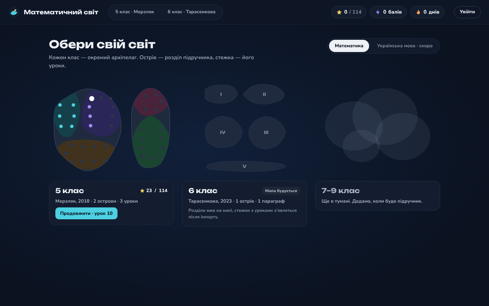

# Math World 🌍➗

**A gamified math learning platform for Ukrainian school students (grades 5–6).**
Lessons from real school textbooks are turned into an interactive map of islands: every lesson is a
stop on the path, every exercise is checked automatically, and students collect points, stars and streaks.

> 🇩🇪 **Kurz auf Deutsch:** Lernplattform für Mathematik (Klassen 5–6, ukrainischer Lehrplan) mit
> Spielmechanik. Backend in Django, eigene PDF-Pipeline (OCR + Vision-LLM), die Schulbücher in
> strukturierte Aufgaben mit automatischer Antwortprüfung umwandelt, JSON-API, Schulverwaltung mit
> Verifizierung und Rollen, über 650 automatisierte Tests.



## Features

- **Learning map & game** – grade → section → paragraph → lesson, points by difficulty, stars, daily streak,
  guest play via session or user account.
- **Automatic answer checking** – numeric answers incl. decimals with comma, fractions and mixed numbers
  (`3,5`, `3/4`, `2 1/3`); free-text solutions can be checked by an LLM with a daily limit.
- **PDF → structured content pipeline** – page rendering, preprocessing (OpenCV), OCR (Tesseract),
  layout & structure detection, difficulty markers, exercises with sub-items, answers and figures;
  a Vision-LLM (Gemini) fixes low-confidence text. Results are validated against a JSON schema and
  imported idempotently (SHA-256 per textbook, import journal, automatic DB backup before import).
- **Human review workflow** – staff page `/review/` with an audit log of manual edits that can be
  exported and re-applied to a fresh database.
- **Schools & roles** – schools register with their official number (ЄДЕБО code / Schulnummer),
  a platform admin verifies them, and a *verified* school manages its own teachers (details below).
- **JSON API** without DRF – consistent error format, rate limiting on answer checks,
  answers are never exposed by GET endpoints.

## Tech stack

| Area | Tools |
|---|---|
| Backend | Python 3, Django 5.2, SQLite (PostgreSQL-ready via Django ORM) |
| Content pipeline | PyMuPDF, OpenCV, Tesseract OCR, RapidFuzz, JSON Schema, Google Gemini API |
| Frontend | Django templates, vanilla JavaScript (ES modules), CSS design tokens, no build step |
| Testing | Django `TestCase` / `unittest` (650+ tests), Node `node --test`, Playwright visual tests |

## Schools: verification and staff management

```
register school (any logged-in user)  ──►  status = pending, registrant = school admin
                     │
      platform admin (superuser) verifies in Django admin
                     ▼
status = verified  ──►  school admin adds / removes its teachers on its own
                     │
      admin revokes verification  ──►  rights are lost immediately (checked live)
```

Data model (`schools/models.py` – its own Django app, since schools/classes have no foreign key
into the curriculum catalog at all):

- `School` – name, country (`UA` / `DE`), official number (unique per country), status
  (`pending` / `verified` / `rejected`), who verified it and when.
  A database **check constraint** guarantees that a verified school always has a verification date.
- `SchoolMembership` – user ↔ school with role `school_admin` or `teacher`, who added them;
  unique per (school, user).

Business rules live in one place, `schools/services.py`, and are used by both the admin and the API:

| Action | Who |
|---|---|
| Register a school | any logged-in user |
| Verify / reject / revoke | platform admin only |
| Add / remove teachers | admin of a **verified** school, or platform admin |
| Remove a school admin | platform admin only |

API:

```
GET    /api/schools/mine/                  my schools, role, can_manage_staff
POST   /api/schools/                       {"name", "country", "official_number", "city"} → 201 pending
GET    /api/schools/<id>/staff/            staff list (members of the school only)
POST   /api/schools/<id>/staff/            {"username"} → 201 | 403 not verified | 409 already member
DELETE /api/schools/<id>/staff/<user_id>/  → 204
```

## Getting started

```bash
git clone https://github.com/AnitaMah/math_world.git
cd math_world
python -m venv .venv && source .venv/bin/activate      # Windows: .venv\Scripts\activate
pip install -r requirements.txt
cp .env.example .env                                    # then set SECRET_KEY
python manage.py migrate
python manage.py createsuperuser
python manage.py runserver
```

Optional – content pipeline: `pip install -r requirements-pipeline.txt -r requirements-llm.txt`
and install Tesseract with the Ukrainian language pack.

## Tests

```bash
python manage.py test                          # backend + pipeline + schools + game
cd tools/frontend && npm install && npm test   # JavaScript unit tests
```

Tests that need a real textbook PDF or Tesseract are skipped automatically when those are not available.

## Project structure

Three Django apps, split by domain (`docs/backend/DECISIONS.md` has the full reasoning):

```
education/          curriculum catalog + PDF import + review (the "core" app)
  models.py          curriculum data model (textbooks, sections, exercises, content blocks)
  api.py, serializers.py, api_urls.py   catalog JSON API
  services.py, review.py, views_review.py   answer checking, manual review workflow
  pdf_pipeline/      PDF → JSON pipeline (OCR, layout, structure, vision, validation)
  importers/         JSON → database import
  management/commands/   import, export, backup/restore, review tools
schools/             schools, roles, classes (no FK into the catalog at all)
  models.py, services.py, api.py, urls.py, admin.py
game/                player progress, points, stars, streaks (depends on the catalog, one-way)
  models.py, services.py, api.py, urls.py, serializers.py
docs/                design decisions, plans and pipeline documentation
tools/frontend/      JS unit tests and Playwright visual tests
```

## Copyright note

The textbooks used to build the content are protected by copyright and are **not** part of this
repository – neither the PDFs nor transcriptions of their pages, nor the database. The repository
contains only the source code. To run the pipeline you need your own legally obtained copy of a textbook.

## Author

Anita Mah – [GitHub](https://github.com/AnitaMah)
